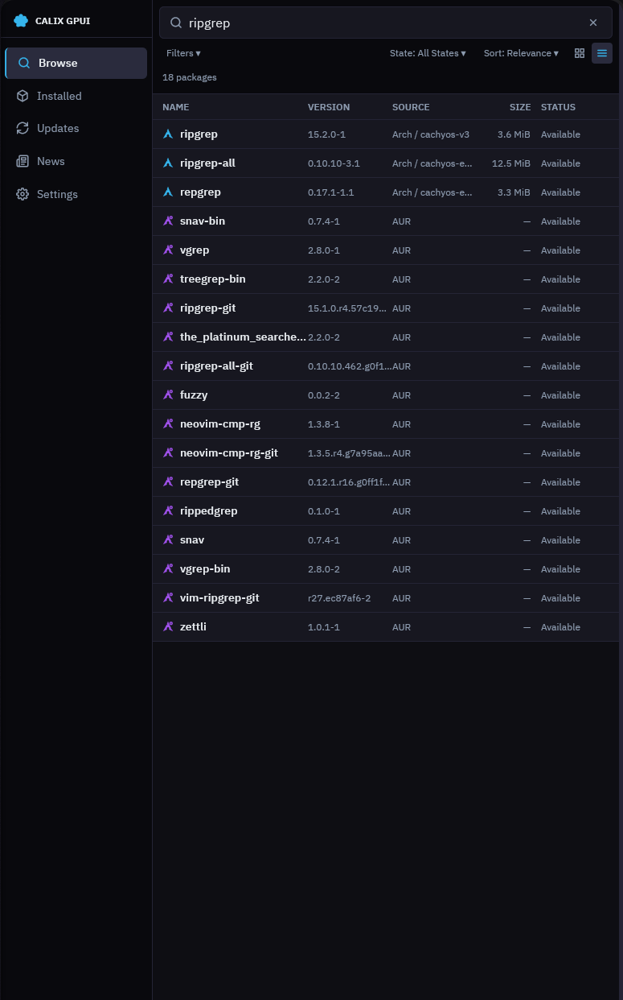
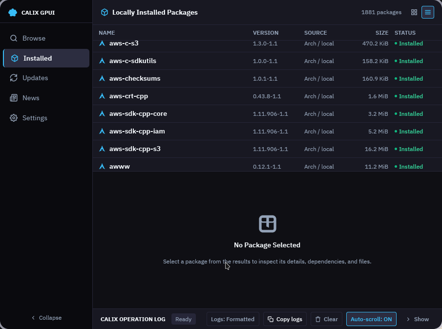
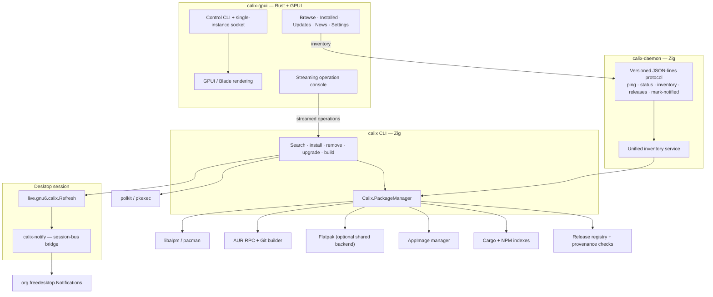

# Calix

**One native desktop surface for every package source on Arch Linux.** Calix unifies
official repositories, the AUR, Flatpak, AppImages, Cargo and NPM into a single GPU-
accelerated application, backed by a Zig package-management engine.

[](https://github.com/tension-atoi/calix/actions/workflows/ci.yml)
[](https://github.com/tension-atoi/calix/releases/latest)
[](LICENSE)
[](https://archlinux.org/)
[](https://github.com/zed-industries/zed/tree/main/crates/gpui)
[](https://ziglang.org/)

<p align="center">
  
  
</p>

<sub>Left — Browse: one search across the ALPM repositories and the AUR, every result
labelled with its source. Right — Installed: 1 911 packages from ALPM, AUR, Flatpak,
AppImage, Cargo, NPM and tracked releases in one table.</sub>

---

## Contents

- [What Calix is](#what-calix-is)
- [Quick start](#quick-start)
- [The four components](#the-four-components)
- [Features](#features)
- [Architecture](#architecture)
- [Privilege model](#privilege-model)
- [Configuration and state](#configuration-and-state)
- [Command line](#command-line)
- [Packaging](#packaging)
- [Development](#development)
- [Project status](#project-status)
- [What is next](#what-is-next)
- [Repository layout](#repository-layout)
- [Documentation](#documentation)
- [Credits and lineage](#credits-and-lineage)
- [License](#license)

---

## What Calix is

Managing software on Arch Linux means moving between `pacman`, an AUR helper, `flatpak`
and whatever handles your AppImages — each with its own output, its own idea of what is
installed, and its own privilege path. Calix collapses that into one coherent surface
without pretending the sources are the same.

Five decisions follow from that:

- **Arch-first, not distro-agnostic.** Calix is built against `libalpm` and the Arch
  package model. It does not abstract Arch into a lowest-common-denominator interface.
- **One inventory, explicit provenance.** Every ecosystem lands in one versioned
  document, and every entry states which ecosystem it came from. A consumer that does
  not understand the document version refuses it instead of rendering it half-understood.
- **A real privilege boundary.** The UI, the daemon and the notification bridge run
  unprivileged. Root happens in one narrow, explicit path through polkit.
- **Native code end to end.** Rust and GPUI for the interface, Zig for package
  management. No web view, no embedded browser, no Electron.
- **Honest state.** The frontend reads one service for cross-ecosystem state, and the
  inventory reports what is installed rather than what should be.

---

## Quick start

### From a release

Every release publishes a tarball and its checksum:

```bash
gh release download v0.2.2 --repo tension-atoi/calix \
  --pattern 'calix-gpui-linux-x86_64.tar.gz*'
sha256sum -c calix-gpui-linux-x86_64.tar.gz.sha256
mkdir -p /tmp/calix && tar -xzf calix-gpui-linux-x86_64.tar.gz -C /tmp/calix
```

The tarball is a `usr/` layout, not an installer: look at it, then copy the pieces you
want.

### From the Arch package

The package is `calix-gpui-git`. Build it and install it through polkit — this project
forbids `sudo`, `su` and `doas`:

```bash
make package
pkexec pacman -U --noconfirm /tmp/calix-gpui-pkg/*.pkg.tar.zst
```

Then enable the two per-user services, if you want them:

```bash
systemctl --user enable --now calix-daemon.service   # inventory service
systemctl --user enable --now calix-notify.service   # desktop notifications
```

### From source

Zig **0.16** and a stable Rust toolchain are required:

```bash
git clone https://github.com/tension-atoi/calix.git
cd calix
make zig                    # calix, calix-daemon, calix-notify
./Calix.Cli.Zig/zig-out/bin/calix-daemon &
make run                    # the GPUI frontend against the in-tree backend
```

Full prerequisites, including how to obtain a Zig 0.16 toolchain on a modern Arch
system, are in [Development](#development).

### Migrating from Shelly

Calix v0.2.0 was a hard cut from the Shelly name. There is no compatibility layer and
the old state paths are not read. The one-time state move, the renamed surfaces and the
old package names are in [`docs/release-notes.md`](docs/release-notes.md).

---

## The four components

| Binary | Language | Role |
|---|---|---|
| `calix-gpui` | Rust + [GPUI 0.2](https://github.com/zed-industries/zed/tree/main/crates/gpui) | The desktop application. Renders on the GPU, owns the search UI, the inspector and the operation console. |
| `calix` | Zig | The package-management CLI and the shared backend library behind it. Talks to `libalpm`, the AUR, Flatpak, AppImages, Cargo and NPM. |
| `calix-daemon` | Zig | The inventory service. Serves a versioned JSON-lines protocol over a Unix socket; the only writer of Calix state. |
| `calix-notify` | Zig | The optional session-bus bridge. Turns Calix's `Refresh` signal into one `org.freedesktop.Notifications` notification. |

The daemon is deliberately not part of the UI process: the UI degrades to what the
backend CLI reports when the daemon is absent, instead of failing to open.

---

## Features

### Interface

- Five destinations: **Browse**, **Installed**, **Updates**, **News** and **Settings**.
- Concurrent search across official repositories, the AUR and Flatpak, plus a local
  filter over installed AppImages, with per-source filters and per-source health.
- A package inspector with three tabs: **Overview**, **Dependencies** (runtime, optional,
  make, conflicts, provides, required-by) and **Files / Build**.
- Table and card result layouts, compact density, light and dark themes.
- A streaming operation console: install, remove and upgrade output arrives line by line
  while the operation runs.
- Single-instance lifetime with a control socket, so a second launch focuses the window
  instead of starting a rival instance.
- A scriptable control CLI — `calix-gpui status --json`, `calix-gpui search …`,
  `calix-gpui navigate installed` — with deterministic exit codes.

### Inventory

- One versioned inventory document covering ALPM, AUR, Flatpak, AppImage, Cargo, NPM and
  tracked release entries.
- The daemon is the frontend's only source for that document; the UI opens no state
  files.
- Graceful degradation: without a running daemon the window still opens and shows the
  ALPM packages the backend CLI reports, and the missing ecosystems are logged rather
  than failing the view.

### Backend operations

- **ALPM** — search, install, remove, partial upgrades, full system upgrade, downgrades,
  ignore/hold marks, pacnew/pacsave management, and package repair.
- **AUR** — search, PKGBUILD review, isolated builds, install, updates.
- **Flatpak** — search, install, remove, update, run and cleanup, with an optional native
  backend that keeps `libflatpak` out of the base binary.
- **AppImage** — install, remove, run, metadata synchronisation and update sources.
- **Cargo / NPM / tracked releases** — reported in the inventory. The UI shows them
  read-only: installing and removing Cargo and NPM packages from the UI is not wired yet.
- **Repository and build tooling** — repository database operations, isolated builds
  through `systemd-nspawn`, keyring management and shell completions.

UI search currently covers ALPM, AUR, Flatpak and the local AppImage list. Cargo, NPM
and tracked releases appear in the installed view, not in search results.

### Desktop integration

- An XDG desktop entry, an SVG icon and a polkit policy, all under the
  `live.gnu6.calix` namespace.
- A notification bridge that turns a completed package operation into one desktop
  notification, without a `dbus-monitor` pipeline or a `notify-send` subprocess.

---

## Architecture



- **`Calix.Ui.Gpui/`** builds `calix-gpui`: GPUI layout and rendering, search
  orchestration, the inspector and the operation console. Mutating operations are
  spawned on a Tokio worker and streamed, so the render thread never blocks on process
  I/O.
- **`Calix.Cli.Zig/`** builds three executables from one library: the `calix` CLI, the
  `calix-daemon` and the `calix-notify` bridge. The daemon checks its protocol version
  before dispatching, so a mismatched client is told so rather than misread.
- **`Calix.PackageManager/`** is the backend library (`Zigalpm` to its Zig consumers):
  ALPM through `libalpm`, the AUR, Flatpak, AppImage, Cargo and NPM managers, the flat
  inventory record shared by every ecosystem, the release registry and upstream
  provenance verification.
- **`Calix.Flatpak.Backend/`** is an optional `libflatpak` shared library loaded at
  runtime, so the base binary has no hard Flatpak dependency. The package builds and
  ships it at `/usr/lib/calix/libcalix-flatpak-backend.so.1`; the Flatpak runtime
  itself stays optional, and without it the library cannot load and Calix runs with
  every other ecosystem.

### The daemon protocol

One JSON object per line, in both directions:

```json
{"version":1,"action":"ping"}
{"version":1,"ok":true,"data":{"pid":4242,"protocol":1,"started_at":1789000000}}
```

The five actions are `ping`, `status`, `inventory`, `releases` and `mark-notified`.

The socket follows the XDG base directory specification:

```text
socket   $XDG_RUNTIME_DIR/calix/daemon.sock   (falls back to /tmp/calix-<uid>/daemon.sock)
state    $XDG_STATE_HOME/calix
```

`calix-daemon --help` lists the `--socket` and `--state-dir` overrides.

### Transitional state

The release-observation file the inventory reads for tracked releases is still produced
by the frozen Python engine in `scripts/`. That engine is a bridge, not the product: it
receives fixes only, no new features, and the Zig release watcher is meant to replace
it. The daemon reads that one file as a bounded bridge and never executes Python.

---

## Privilege model

Calix has exactly one elevation path: **polkit**.

| Process | Runs as | Root work |
|---|---|---|
| `calix-gpui` | user | none |
| `calix-daemon` | user | none |
| `calix-notify` | user | none |
| `calix` (mutating commands) | user, then `pkexec` | ALPM transactions, AUR builds, keyring changes |

- The project's engineering policy forbids `sudo`, `su` and `doas` — including in
  scripts, CI and documentation. Elevation is `pkexec`, and the CLI rejects the other
  mechanisms even when they are explicitly configured.
- The `live.gnu6.calix.policy` file declares the three polkit actions the UI can
  request: install, remove and upgrade.
- The daemon and the notification bridge are unprivileged by construction, and the
  package installs both units without enabling them, so installing Calix never changes
  a session it was not asked to change.

---

## Configuration and state

| Path | Contents |
|---|---|
| `$XDG_CONFIG_HOME/calix` | User configuration (`config.json`), UI settings (`gpui-ui.json`), the AppImage metadata database |
| `$XDG_STATE_HOME/calix` | Daemon state: per-ecosystem inventories, release observations, the operation journal and the log |
| `$XDG_RUNTIME_DIR/calix/daemon.sock` | The daemon socket |
| `$XDG_RUNTIME_DIR/calix-gpui/` | Control socket and instance lock for the frontend |

Environment variables:

| Variable | Purpose |
|---|---|
| `CALIX_BIN` | Path to the `calix` backend binary the frontend should drive |
| `CALIX_ELEVATOR` | Explicit elevation mechanism; `pkexec` is the default and the only allowed one |
| `CALIX_CONFIG_DIR` | Overrides the configuration directory |
| `CALIX_APPIMAGE_DB` | Overrides the AppImage metadata database path |

---

## Command line

The backend CLI is `calix`. It speaks a compact grammar — an uppercase action, a
lowercase type, then flags — alongside plain subcommands:

```bash
# Search
calix search standard firefox
calix search aur ripgrep
calix -Ss firefox                    # the same thing, in short form

# Install, remove, upgrade
calix install standard firefox
calix install aur ripgrep
calix remove standard firefox
calix upgrade all

# The unified inventory document (all six ecosystems, versioned JSON)
calix inventory standard

# Every command, its flags and its examples
calix --help
```

The frontend has its own control surface, with a machine-readable mode:

```bash
calix-gpui status --json          # protocol version, destination, query, selected package
calix-gpui search ripgrep         # drive a running window
calix-gpui navigate installed     # switch destination
calix-gpui view cards             # table or cards
calix-gpui inspect firefox        # open the inspector
calix-gpui quit                   # close the running instance
```

Exit codes are deterministic: `0` on success, `1` on failure, with the same meaning in
human and `--json` mode.

---

## Packaging

The Arch package is defined by [`PKGBUILD-calix`](PKGBUILD-calix), with
[`packaging/aur/PKGBUILD`](packaging/aur/PKGBUILD) as a symlink to it so the AUR copy
cannot drift from the in-tree one.

Zig 0.16 is required. `make package` selects `vendor/zig-0.16/usr/bin/zig` when it
exists and exports it as `ZIG`; the PKGBUILD rejects any other Zig version with an
actionable error.

```bash
make package
pkexec pacman -U --noconfirm /tmp/calix-gpui-pkg/*.pkg.tar.zst
```

The package (`calix-gpui-git`) installs:

| Path | Contents |
|---|---|
| `/usr/bin/calix-gpui` | Wrapper that sets `CALIX_BIN` and execs the frontend |
| `/usr/bin/calix` | Symlink to the backend CLI |
| `/usr/bin/calix-daemon` | Symlink to the inventory daemon |
| `/usr/bin/calix-notify` | Symlink to the notification bridge |
| `/usr/lib/calix/calix-gpui` | GPUI frontend binary |
| `/usr/lib/calix/calix` | Zig backend CLI (the canonical polkit path) |
| `/usr/lib/calix/calix-daemon` | Zig inventory daemon |
| `/usr/lib/calix/calix-notify` | Session-bus notification bridge |
| `/usr/lib/calix/libcalix-flatpak-backend.so.1` | Optional Flatpak backend, loaded at runtime |
| `/usr/lib/systemd/user/calix-daemon.service` | Per-user inventory service |
| `/usr/lib/systemd/user/calix-notify.service` | Per-user notification bridge |
| `/usr/share/applications/live.gnu6.calix.desktop` | XDG desktop entry |
| `/usr/share/icons/hicolor/scalable/apps/live.gnu6.calix.svg` | Application icon |
| `/usr/share/polkit-1/actions/live.gnu6.calix.policy` | Polkit actions for install / remove / upgrade |

Two boundaries are deliberate:

- **Both user services are installed but not enabled.** Enabling a user unit is a
  per-account decision; the package leaves it to `systemctl --user enable --now`.
- **The legacy systemd units in `packaging/systemd/` run the frozen Python engine**
  (`calix sync`), not the daemon. They are not installed by this package and remain part
  of the transitional state described above.

---

## Development

### Prerequisites

Arch Linux (or an Arch-based distribution), `x86_64`:

```bash
pkexec pacman -S --needed base-devel git rust cargo pacman clang pkgconf \
  libglvnd fontconfig freetype2 wayland libx11 libxcb libxkbcommon \
  libxkbcommon-x11 mesa vulkan-icd-loader polkit dbus
```

Zig **0.16.0** is required. `Calix.Cli.Zig/build.zig.zon` declares
`minimum_zig_version = "0.16.0"`; Zig 0.17 changed the build API and this tree does
not build with it. Arch's `zig` package has moved past 0.16, so check `zig version`
before building.

If the system Zig is not 0.16, extract the 0.16.0 package — from the pacman cache or the
Arch Linux Archive — into the git-ignored `vendor/` directory and put it first on
`PATH`:

```bash
mkdir -p vendor/zig-0.16
bsdtar -xf /path/to/zig-0.16.0-*.pkg.tar.zst -C vendor/zig-0.16
export PATH="$PWD/vendor/zig-0.16/usr/bin:$PATH"
zig version   # 0.16.0
```

That binary is linked against LLVM 21 (`libLLVM.so.21.1`, `libclang-cpp.so.21.1`,
`liblld*.so.21.1`). If your system has moved to a newer LLVM, install the matching
versioned packages — `clang21 lld21 llvm21-libs` — from the same snapshot or the Arch
Linux Archive, or `zig` will fail to start.

Flatpak support is a separate shared library that the CLI loads at runtime. The
package builds and ships it; to build it from source you need the Flatpak development
files, and the base CLI never links `libflatpak`. From a checkout, point the CLI at the
backend you just built:

```bash
(cd Calix.Flatpak.Backend && zig build -Doptimize=ReleaseSafe)
(cd Calix.Cli.Zig && zig build -Doptimize=ReleaseSafe \
  -Dflatpak-backend-path="$PWD/../Calix.Flatpak.Backend/zig-out/lib/libcalix-flatpak-backend.so.1")
```

### Make targets

| Target | What it does |
|---|---|
| `make run` | Development run of the GPUI frontend against the local Zig CLI |
| `make build` | Optimised release build of `calix-gpui` |
| `make check` | Fast `cargo check` without linking |
| `make test` | Rust test suite for the frontend |
| `make zig` / `make zig-rebuild` | Build the Zig backend: CLI, daemon and notification bridge |
| `make package` | Build the Arch package in `/tmp` (`makepkg --noconfirm`); does not install |
| `make package-install` | Build the package, then install it through `pkexec` |
| `make install` | Development install into `/usr/local` (no PKGBUILD; needs elevated privileges) |
| `make clean` | Remove Rust and Zig build artefacts |

### The gate

Every change is proven locally before it is pushed. There is no "try it on CI" step.

```bash
./scripts/verify        # the same gate CI runs: naming, tests, release builds, smoke
./scripts/ci-replay     # the same gate again, inside a clean archlinux:latest container
```

`scripts/verify` runs the PackageManager suite, the CLI suite, the Rust suite, the
release builds and a CLI smoke test. `scripts/ci-replay` replays that gate inside a
pinned Arch snapshot, so a local pass and a CI pass cannot mean different things.

The gate also checks that every shipped binary stays inside the x86_64 baseline. Zig's
native CPU model bakes the build machine's instruction set into a binary and emits it
without a runtime check, so an artifact built on an AMD machine dies with `SIGILL` on
an Intel one the first time it opens a TLS connection. Every Zig build in this tree
resolves the baseline CPU model, and a binary that uses an instruction above it fails
the gate.

Current counts: **1 386** PackageManager tests, **392** CLI tests, **201** Rust tests.

### Evidence

`evidence/runs/` holds one machine-readable record per run — the local gate, the
container replay, packaging, installs and releases — each with its raw logs under
`evidence/logs/`. A run record states what was proven and, just as importantly, what
was not.

### The naming boundary

The product was renamed from Shelly to Calix. The old name survives only in the
historical record: `README.md`, `docs/` and `evidence/`. Code, packaging, paths,
binaries and scripts use the Calix name, and `scripts/check-naming` is the tripwire
that keeps it that way.

---

## Project status

Calix is pre-1.0. The table below is the honest current state; if it disagrees with a
more optimistic document elsewhere in the tree, this table is the one to trust.

| Area | State |
|---|---|
| GPUI frontend (`calix-gpui`) | Primary interface; active development |
| Zig backend CLI (`calix`) | Works. The Flatpak ecosystem is optional: without the backend the inventory document carries every other ecosystem and nothing else |
| `calix-daemon` | Serves inventory and release state on demand; **no scheduler yet** |
| Unified inventory | ALPM, AUR, Flatpak, AppImage, Cargo, NPM, tracked releases |
| Release tracking | Zig registry and provenance checks landed; a frozen Python engine still writes the tracked-release observation file |
| UI mutations | ALPM, AUR, Flatpak only |
| UI search | ALPM, AUR, Flatpak, installed AppImages only |
| Desktop notifications | `calix-notify` shipped and verified end to end on a live session; installed, not enabled by default |
| Packaging | Installs the frontend, the backend CLI, the notification bridge and both user services |
| Naming | Complete: code, paths, binaries and packaging use `calix` and `live.gnu6.calix` |
| Platform | Arch Linux, `x86_64` |

The frontend crate is version `0.2.2`. The Zig backend reports `3.1.9-dev`, a version
string inherited from the tree it descends from; it is not the Calix product version.

---

## What is next

In rough order of value:

1. **The daemon scheduler and the Zig release watcher.** The daemon currently answers
   on demand; a scheduler and a native release watcher would retire the frozen Python
   bridge and make tracked releases continuous instead of sampled.
2. **Wire the application flow.** A dedicated root helper and a narrower polkit action
   set, so the UI asks for exactly the operation it needs instead of a general CLI
   invocation.
3. **Close the mutation gap.** Installing and removing Cargo and NPM packages from the
   UI, and searching the sources that are currently inventory-only.
4. **Cut the frozen Python engine.** Once the watcher is native, `scripts/calix_*.py`
   and the legacy `packaging/systemd/calix-sync.*` units can go.

Just before this list: `v0.2.2` shipped the optional Flatpak backend in the package,
stopped a command from running the inventory instead of its own job, and rebuilt every
Zig binary for the x86_64 baseline so the artifact runs on Intel CPUs as well as AMD
ones. All three were wrong in `v0.2.1`.

---

## Repository layout

| Path | Contents |
|---|---|
| `Calix.Ui.Gpui/` | Rust + GPUI frontend (crate `calix-gpui`) |
| `Calix.Cli.Zig/` | Zig CLI (`calix`), daemon (`calix-daemon`) and notification bridge (`calix-notify`) |
| `Calix.PackageManager/` | Zig backend library: ALPM, AUR, Flatpak, AppImage, Cargo, NPM, release registry |
| `Calix.Flatpak.Backend/` | Optional `libflatpak` shared library, loaded at runtime |
| `Calix.Http/`, `Calix.Diagnostics/` | Supporting Zig components |
| `scripts/` | The local gate, the CI replay, and the frozen Python engine (transitional) |
| `docs/` | Current docs plus dated slice records and render-lab evidence |
| `docs/media/` | Screenshots used by this README |
| `packaging/` | AUR symlink, the two user services and the legacy sync units |
| `evidence/` | Machine-readable run records and raw logs |
| `PKGBUILD-calix` | The current Arch package definition |
| `vendor/` | Local toolchain cache, git-ignored |

All live directories use the `Calix.` prefix. The historical `Shelly.` names are
recorded only in [`docs/legacy-references.md`](docs/legacy-references.md).

---

## Documentation

| Document | What it covers |
|---|---|
| [`docs/release-notes.md`](docs/release-notes.md) | Release notes and the Shelly migration guide |
| [`docs/calix-architecture.md`](docs/calix-architecture.md) | How the components fit together |
| [`docs/ci.md`](docs/ci.md) | The CI workflow, caches, timeouts and how to diagnose a red run |
| [`docs/isolated-builds.md`](docs/isolated-builds.md) | Isolated AUR builds through `systemd-nspawn` |
| [`docs/flatpak-backend-abi.md`](docs/flatpak-backend-abi.md) | The optional Flatpak backend ABI |
| [`docs/gpui/`](docs/gpui/) | The front-end slice kits: the work contracts, the render lab, the UX workbench, and the Slice-07 information architecture and navigation plan |
| [`docs/legacy-references.md`](docs/legacy-references.md) | The historical name boundary and the rename map |
| [`CONTRIBUTING.md`](CONTRIBUTING.md) | Architecture overview and how to propose a change |
| [`SECURITY.md`](SECURITY.md) | Reporting a vulnerability |
| [`MANUAL_TESTING.md`](MANUAL_TESTING.md) | The manual checklist for behaviour that cannot be automated |

---

## Credits and lineage

### Historical lineage

Calix is historically forked from **Shelly**
([Seafoam-Labs/Shelly-ALPM](https://github.com/Seafoam-Labs/Shelly-ALPM)). Shelly was
created by **Zoey Erin Bauer** and developed with contributors including
**Caroline Snyder** and **Anton Ždanov**, alongside many others in the Seafoam Labs
community. Their work on the Shelly backend, packaging and documentation is the origin
of a substantial part of this codebase.

They are credited here as the authors of the origin project. They are not maintainers of
Calix, and their presence in this repository's history should not be read as an
endorsement of or active involvement in Calix.

The full upstream commit history and an `upstream` git remote are retained for
reference and attribution. The codebase was developed here under the name
`shelly-gpui` and renamed to **Calix** in October 2026. Since the fork it has been
deeply refactored and redirected:

- the Rust / GPUI frontend became the primary interface;
- a separate `calix-daemon` became the boundary for installed-package state;
- the installed-package model was unified across six ecosystems;
- packaging, naming, protocol and roadmap diverged from upstream.

Calix is not a clone of Shelly, and it is not a live continuation of the Shelly project.
Upstream Shelly continues independently.

### Technical acknowledgements

- [Zed Industries](https://github.com/zed-industries/zed) for
  [GPUI](https://github.com/zed-industries/zed/tree/main/crates/gpui), the GPU UI
  framework this frontend is built on.
- The Blade Graphics project, for the rendering layer used through GPUI.
- The Tokio project, for the async runtime that keeps process I/O off the render thread.
- The Arch Linux project and `libalpm`/pacman, which own the package format and the
  system transaction semantics Calix depends on.
- The Flatpak project and its maintainers, for the optional backend.
- The Zig project and the authors of the Zig packages vendored under the component
  directories.

### Current maintainers

Calix is maintained by **tension-atoi**
([@tension-atoi](https://github.com/tension-atoi)). The `authors` field in
`Calix.Ui.Gpui/Cargo.toml` still lists Seafoam Labs alongside the current maintainer for
historical attribution; it does not describe current maintenance.

Parts of the recent Calix work were produced with AI coding agents under maintainer
direction and review. The maintainer is responsible for what is merged.

---

## License

Calix is distributed under the **GNU General Public License v3.0 only**
(`GPL-3.0-only`), as declared in `Calix.Ui.Gpui/Cargo.toml` and `PKGBUILD-calix`. See
[`LICENSE`](LICENSE) for the full text.

The project inherits its license from its Shelly lineage; upstream Shelly is also
GPL-3.0.
