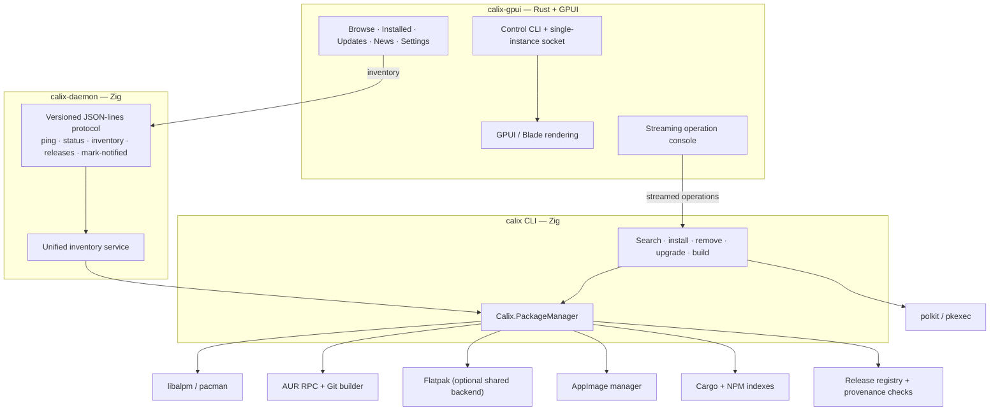

# Calix

**A fast, GPU-accelerated package manager for Arch Linux.** Calix unifies the official
repositories, the AUR, Flatpak and AppImage sources with your Cargo and NPM installs in
one native desktop application, backed by a Zig package-management engine.

Calix is pre-1.0 software under active development. Its scope and internals change
frequently; [Project status](#project-status) is part of the documentation, not an
afterthought.

[](LICENSE)
[](https://archlinux.org/)
[](https://www.rust-lang.org/)
[](https://ziglang.org/)

---

## Overview

Calix is built from three native pieces:

- **`calix-gpui`** — the desktop application. Rust, built on
  [GPUI 0.2](https://github.com/zed-industries/zed/tree/main/crates/gpui) and Blade.
  It renders directly on the GPU; there is no web view and no embedded browser.
- **`calix-daemon`** — the inventory service. Zig, serving a versioned JSON-lines
  protocol over a Unix socket. The frontend reads the daemon rather than opening state
  files, so there is one place where installed-package state is assembled.
- **`calix`** — the package-management CLI and the shared backend library behind it.
  Zig, talking to `libalpm`, the AUR, Flatpak, AppImages, Cargo and NPM.

The UI and the daemon run unprivileged. Operations that need root go through the CLI and
polkit (`pkexec`); the project's engineering policy forbids `sudo`, `su` and `doas`.

Calix targets Arch Linux on `x86_64`. That is the only architecture `PKGBUILD-calix`
declares; other Arch-based distributions may work but are not tested.

---

## History & lineage

Calix is **historically forked from Shelly**, the Arch Linux package manager developed by
[Seafoam Labs](https://github.com/Seafoam-Labs/Shelly-ALPM). This codebase descends from
Shelly's Zig package-management backend, its ALPM / AUR / Flatpak / AppImage work, and
much of its component layout. The full upstream commit history and an `upstream` git
remote are retained for reference and attribution.

The codebase was developed here under the name `shelly-gpui` and renamed to **Calix** in
October 2026. Since the fork it has been deeply refactored and redirected:

- the Rust / GPUI frontend became the primary interface;
- a separate `calix-daemon` became the boundary for installed-package state;
- the installed-package model was unified across six ecosystems;
- packaging, naming, protocol and roadmap diverged from upstream.

Calix is not a clone of Shelly, and it is not a live continuation of the Shelly project.
Upstream Shelly continues independently. Calix maintains historical lineage with it
without being equivalent to the original fork — the lineage is context for how this
codebase came to be, not the definition of what it is now.

The rename is complete. The historical mapping and the reasons behind the new
identifiers are recorded in [`docs/legacy-references.md`](docs/legacy-references.md).

---

## Why Calix

Managing software on Arch Linux means moving between `pacman`, an AUR helper, `flatpak`,
and whatever manages your AppImages — each with its own output, its own idea of what is
installed, and its own privilege path. Calix exists to make that one coherent surface
without hiding the differences between sources.

The design choices that follow from that:

- **Arch-first, not distro-agnostic.** Calix is built against `libalpm` and the Arch
  package model. It does not abstract Arch into a lowest-common-denominator interface.
- **One inventory, explicit provenance.** Installed packages from ALPM, AUR, Flatpak,
  AppImage, Cargo and NPM are reported in one document, and every entry says which
  ecosystem it came from. The document is versioned; a consumer that does not understand
  the version refuses it instead of rendering it half-understood.
- **A real privilege boundary.** The UI and the daemon do not run as root. Elevation
  happens in a narrow, explicit path through polkit.
- **Native code for the interface and the backend.** Rust for the UI, Zig for the package
  management, no web view and no embedded browser. The one exception is the frozen Python
  release-observation bridge described under [Transitional state](#transitional-state),
  which is being removed.
- **Honest state.** The frontend reads one service for cross-ecosystem state instead of a
  pile of state files, and the inventory reports what is installed rather than what
  should be.

---

## Features

### Interface

- Five destinations: **Browse**, **Installed**, **Updates**, **News** and **Settings**.
- Concurrent search across official repositories, the AUR and Flatpak, plus a local
  filter over installed AppImages, with per-source filters and per-source health
  reporting.
- Package inspector with three tabs: **Overview**, **Dependencies** (runtime, optional,
  make, conflicts, provides, required-by) and **Files / Build**.
- Table and card result layouts, compact density, and light and dark themes.
- A streaming operation console: install, remove and upgrade commands run through the
  backend CLI and their output is streamed line by line into the UI.
- Single-instance lifetime with a control socket, plus a small control CLI
  (`calix-gpui status`, `calix-gpui search …`, `calix-gpui navigate installed`, …).

### Inventory

- One versioned inventory document covering ALPM, AUR, Flatpak, AppImage, Cargo, NPM and
  tracked release entries.
- The daemon is the frontend's only source for that document; the UI no longer opens
  state files.
- Graceful degradation: if the daemon is not running, the window still opens and shows the
  ALPM packages the backend CLI reports; the missing ecosystems are logged rather than
  failing the view.

### Backend operations

- **ALPM** — search, install, remove, partial upgrades, full system upgrade, downgrades,
  ignore/hold lists, pacnew/pacsave management.
- **AUR** — search, PKGBUILD review, build and install, updates.
- **Flatpak** — search, install, remove, update, run, cleanup, with an optional native
  backend that keeps `libflatpak` out of the base binary.
- **AppImage** — install, remove, run, metadata synchronisation and update sources.
- **Cargo / NPM / tracked releases** — reported in the inventory. The UI shows them
  read-only: installing and removing Cargo and NPM packages from the UI is not wired yet.
- **Repository and build tooling** — repository database operations, isolated builds
  through `systemd-nspawn`, keyring management and shell completions.

Search in the UI currently covers ALPM, AUR, Flatpak and the local AppImage list. Cargo,
NPM and tracked releases appear in the installed view, not in search results.

---

## Architecture



- **`Calix.Ui.Gpui/`** builds `calix-gpui`: GPUI layout and rendering, search
  orchestration, the inspector, and the operation console. Mutating operations are
  spawned on a Tokio worker and streamed; the render thread is not blocked by process
  I/O.
- **`Calix.Cli.Zig/`** builds two executables from one library: the `calix` CLI and
  `calix-daemon`. The daemon checks its protocol version before dispatching an action,
  so a mismatched client is told so rather than misread.
- **`Calix.PackageManager/`** is the backend library (`Zigalpm` to its Zig consumers):
  ALPM through `libalpm`, AUR, Flatpak, AppImage, Cargo and NPM managers, the flat
  inventory record shared by every ecosystem, the release registry, and upstream
  provenance verification.
- **Flatpak is optional by construction.** `libflatpak` lives in a separate
  `Calix.Flatpak.Backend` shared library loaded at runtime, so the base CLI starts and
  works on a system without Flatpak installed.

### Transitional state

The release-observation file the inventory reads for tracked releases is still produced
by the frozen Python engine in `scripts/`. That engine is a bridge, not the product: it
receives fixes only, no new features, and the Zig release watcher is intended to replace
it. The daemon reads that one file as a bounded bridge and does not execute Python.

---

## Installation & building

### Prerequisites

Arch Linux (or an Arch-based distribution), `x86_64`. Install the build dependencies
with pacman — elevated through polkit, per this project's policy:

```bash
pkexec pacman -S --needed base-devel git rust cargo pacman clang pkgconf \
  libglvnd fontconfig freetype2 wayland libx11 libxcb libxkbcommon \
  libxkbcommon-x11 mesa vulkan-icd-loader polkit
```

Zig **0.16.0** is required. `Calix.Cli.Zig/build.zig.zon` declares
`minimum_zig_version = "0.16.0"`; Zig 0.17 changed the build API and this tree does not
build with it. Arch's `zig` package has moved past 0.16, so check `zig version` before
building.

If the system Zig is not 0.16, extract the 0.16.0 package — from the pacman cache or the
Arch Linux Archive — into the git-ignored `vendor/` directory and put it first on `PATH`:

```bash
mkdir -p vendor/zig-0.16
bsdtar -xf /path/to/zig-0.16.0-*.pkg.tar.zst -C vendor/zig-0.16
export PATH="$PWD/vendor/zig-0.16/usr/bin:$PATH"
zig version   # 0.16.0
```

That binary is linked against LLVM 21 (`libLLVM.so.21.1`, `libclang-cpp.so.21.1`,
`liblld*.so.21.1`). If your system has moved to a newer LLVM, install the matching
versioned packages — `clang21 lld21 llvm21-libs` — from the same snapshot or the Arch
Linux Archive, or `zig` will fail to start.

`make zig`, `make run` and `make build` use `zig` from `PATH`, so keep that export in the
shell that runs them.

Flatpak support additionally needs the Flatpak development files and a separately built
`Calix.Flatpak.Backend`; the base CLI does not link `libflatpak`.

### Migrating from Shelly

Calix v0.2.0 is a hard cut from the Shelly name. There is no compatibility layer and
the old state paths are not read. The one-time state move, the renamed surfaces and the
old package names are in [`docs/release-notes.md`](docs/release-notes.md).

### Build and run from source

```bash
git clone https://github.com/tension-atoi/calix.git
cd calix

# 1. Build the Zig backend: produces Calix.Cli.Zig/zig-out/bin/calix
#    and Calix.Cli.Zig/zig-out/bin/calix-daemon
make zig

# 2. Start the daemon (serves the unified inventory on
#    $XDG_RUNTIME_DIR/calix/daemon.sock)
./Calix.Cli.Zig/zig-out/bin/calix-daemon

# 3. In another terminal, run the UI in development mode
make run
```

`make run` builds the Zig CLI if the binary is missing, then starts `cargo run` with
`CALIX_BIN` pointed at the in-tree backend. The daemon is a separate process and is not
started by the UI: without it, the window still opens but only the packages the backend
CLI reports are shown.

Other `make` targets:

| Target | What it does |
|---|---|
| `make run` | Development run of the GPUI frontend against the local Zig CLI |
| `make build` | Optimised release build of `calix-gpui` |
| `make check` | Fast `cargo check` without linking |
| `make test` | Rust test suite for the frontend |
| `make zig` / `make zig-rebuild` | Build the Zig backend (and `calix-daemon`) |
| `make package` | Build the Arch package in `/tmp` (`makepkg --noconfirm`); does not install |
| `make package-install` | Build the package, then install it through `pkexec` |
| `make install` | Development install into `/usr/local` (no PKGBUILD; needs elevated privileges) |
| `make clean` | Remove Rust and Zig build artefacts |

Backend tests run from the component directories:

```bash
(cd Calix.Cli.Zig && zig build test)
(cd Calix.PackageManager && zig build test)
```

### Release build

```bash
make build
# binary: Calix.Ui.Gpui/target/release/calix-gpui
```

---

## Usage

### Desktop application

Start `calix-daemon`, then launch `calix-gpui`. The main surfaces:

- **Browse** — search and filter packages across the enabled sources; select a result to
  open the inspector.
- **Installed** — installed ALPM packages, plus the Cargo, NPM and tracked-release entries
  the daemon contributes. Flatpak and AppImage packages remain in their source-filtered
  search views.
- **Updates** — available updates; **Upgrade All** runs a coordinated upgrade through the
  backend CLI.
- **News** — Arch Linux news fetched from the official RSS feed by the backend.
- **Settings** — source toggles, package-management options, theme and density.

Install, remove and upgrade operations open the operation console and stream the backend
CLI output. Root operations raise a polkit prompt.

### Command line

The backend CLI is invoked as `calix`:

```bash
# Search
./Calix.Cli.Zig/zig-out/bin/calix search standard firefox
./Calix.Cli.Zig/zig-out/bin/calix search aur <package>

# Install / remove / upgrade
./Calix.Cli.Zig/zig-out/bin/calix install standard <package>
./Calix.Cli.Zig/zig-out/bin/calix install aur <package>
./Calix.Cli.Zig/zig-out/bin/calix remove standard <package>
./Calix.Cli.Zig/zig-out/bin/calix upgrade all

# The unified inventory document (all six ecosystems, versioned JSON)
./Calix.Cli.Zig/zig-out/bin/calix inventory standard

# Full command surface
./Calix.Cli.Zig/zig-out/bin/calix --help
```

The daemon's defaults follow the XDG base directory specification:

```text
socket   $XDG_RUNTIME_DIR/calix/daemon.sock   (falls back to /tmp/calix-<uid>/daemon.sock)
state    $XDG_STATE_HOME/calix
```

`calix-daemon --help` lists the `--socket` and `--state-dir` overrides. The protocol is
one JSON object per line; a request is
`{"version":1,"action":"inventory"}` and a response is `{"version":1,"ok":true,"data":…}`.

---

## Packaging

The current Arch package is defined by [`PKGBUILD-calix`](PKGBUILD-calix), with
[`packaging/aur/PKGBUILD`](packaging/aur/PKGBUILD) as a symlink to it so the AUR copy
cannot drift from the in-tree one.

Zig 0.16 is required. `make package` selects `vendor/zig-0.16/usr/bin/zig` when it
exists and exports it as `ZIG`; `PKGBUILD-calix` rejects any other Zig version with a
clear message. If you invoke `makepkg` yourself, pass the toolchain explicitly:

```bash
# Build as your user; installation is elevated through polkit, not sudo.
make package
pkexec pacman -U --noconfirm /tmp/calix-gpui-pkg/*.pkg.tar.zst
```

For a direct `makepkg` run in `packaging/aur`, set `ZIG` to an absolute 0.16 binary:

```bash
cd packaging/aur
ZIG=/absolute/path/to/zig-0.16/usr/bin/zig makepkg --noconfirm
```

Enable the per-user inventory service after installation:

```bash
systemctl --user enable --now calix-daemon.service
```

The package installs the unit but does not enable it, so installing Calix never
changes a session the package manager was not asked to touch.

The package (`calix-gpui-git`) installs:

| Path | Contents |
|---|---|
| `/usr/bin/calix-gpui` | Wrapper that sets `CALIX_BIN` and execs the frontend |
| `/usr/bin/calix` | Symlink to the backend CLI |
| `/usr/bin/calix-daemon` | Symlink to the inventory daemon |
| `/usr/lib/calix/calix-gpui` | GPUI frontend binary |
| `/usr/lib/calix/calix` | Zig backend CLI (canonical polkit path) |
| `/usr/lib/calix/calix-daemon` | Zig inventory daemon |
| `/usr/lib/systemd/user/calix-daemon.service` | Per-user inventory service |
| `/usr/share/applications/live.gnu6.calix.desktop` | XDG desktop entry |
| `/usr/share/icons/hicolor/scalable/apps/live.gnu6.calix.svg` | Application icon |
| `/usr/share/polkit-1/actions/live.gnu6.calix.policy` | Polkit actions for install / remove / upgrade |

Two boundaries are deliberate:

- **The daemon service is installed but not enabled.** Enabling a user unit is a
  per-account decision; the package leaves it to `systemctl --user enable --now`.
- **The legacy systemd units in `packaging/systemd/` run the frozen Python engine**
  (`calix sync`), not the daemon. They are not installed by this package and remain
  part of the transitional state described above.

---

## Project status

Calix is pre-1.0. The table below is the honest current state; if it disagrees with a
more optimistic document elsewhere in the tree, this table is the one to trust.

| Area | State |
|---|---|
| GPUI frontend (`calix-gpui`) | Primary interface; active development |
| Zig backend CLI (`calix`) | Works |
| `calix-daemon` | Serves inventory and release state on demand; **no scheduler yet** |
| Unified inventory | ALPM, AUR, Flatpak, AppImage, Cargo, NPM, tracked releases |
| Release tracking | Zig registry and provenance checks landed; a frozen Python engine still writes the tracked-release observation file |
| UI mutations | ALPM, AUR, Flatpak only |
| UI search | ALPM, AUR, Flatpak, installed AppImages only |
| Packaging | Installs frontend, backend CLI and the `calix-daemon` user service |
| Naming | Complete: code, paths, binaries and packaging use `calix` and `live.gnu6.calix` |
| Platform | Arch Linux, `x86_64` |

Planned next steps, in rough order: the daemon scheduler and release watcher, the
application flow (root helper + polkit rule), and removal of the frozen Python engine.

The frontend crate is version `0.2.0`. The Zig backend reports `3.1.9-dev`, a version
string inherited from the Shelly tree it descends from; it is not the Calix product
version.

---

## Repository structure

| Path | Contents |
|---|---|
| `Calix.Ui.Gpui/` | Rust + GPUI frontend (crate `calix-gpui`) |
| `Calix.Cli.Zig/` | Zig CLI (`calix`) and daemon (`calix-daemon`) |
| `Calix.PackageManager/` | Zig backend library: ALPM, AUR, Flatpak, AppImage, Cargo, NPM, release registry |
| `Calix.Flatpak.Backend/` | Optional `libflatpak` shared library, loaded at runtime |
| `Calix.Http/`, `Calix.Diagnostics/` | Supporting Zig components |
| `scripts/` | Frozen Python engine and operational scripts (transitional) |
| `docs/` | Current docs plus dated slice records and render-lab evidence; historical names may appear in the dated records |
| `packaging/` | AUR symlink, daemon user service and legacy sync units |
| `PKGBUILD-calix` | The current Arch package definition |
| `vendor/` | Local toolchain cache, git-ignored |

All live directories use the `Calix.` prefix. The historical `Shelly.` names are
recorded only in [`docs/legacy-references.md`](docs/legacy-references.md).

---

## Credits & acknowledgements

### Historical lineage

Calix is historically forked from **Shelly**
([Seafoam-Labs/Shelly-ALPM](https://github.com/Seafoam-Labs/Shelly-ALPM)). Shelly was
created by **Zoey Erin Bauer** and developed with contributors including
**Caroline Snyder** and **Anton Ždanov**, alongside many others in the Seafoam Labs
community. Their work on the Shelly backend, packaging and documentation is the origin
of a substantial part of this codebase.

They are credited here as the authors of the origin project. They are not maintainers of
Calix, and their presence in this repository's history should not be read as an
endorsement of or active involvement in Calix.

### Technical acknowledgements

- [Zed Industries](https://github.com/zed-industries/zed) for
  [GPUI](https://github.com/zed-industries/zed/tree/main/crates/gpui), the GPU UI
  framework this frontend is built on.
- The Blade Graphics project, for the rendering layer used through GPUI.
- The Tokio project, for the async runtime that keeps process I/O off the render thread.
- The Arch Linux project and `libalpm`/pacman, which own the package format and the
  system transaction semantics Calix depends on.
- The Flatpak project and its maintainers, for the optional backend.
- The Zig project and the authors of the Zig packages vendored under the component
  directories.

### Current maintainers

Calix is maintained by **tension-atoi**
([@tension-atoi](https://github.com/tension-atoi)). The `authors` field in
`Calix.Ui.Gpui/Cargo.toml` still lists Seafoam Labs alongside the current maintainer
for historical attribution; it does not describe current maintenance.

Parts of the recent Calix work were produced with AI coding agents under maintainer
direction and review. The maintainer is responsible for what is merged.

---

## License

Calix is distributed under the **GNU General Public License v3.0 only**
(`GPL-3.0-only`), as declared in `Calix.Ui.Gpui/Cargo.toml` and `PKGBUILD-calix`. See
[`LICENSE`](LICENSE) for the full text.

The project inherits its license from its Shelly lineage; upstream Shelly is also
GPL-3.0.
